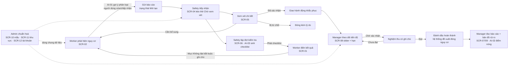

# Bảng kiểm kê màn hình — SiteSafe (CSE122)

- **Dự án:** SiteSafe – Theo dõi an toàn công trường
- **Học phần:** Phát triển ứng dụng Web cơ bản (CSE122) – Đại học Thủy lợi
- **Nhóm:** 16 · **Mã đề tài:** CSE.TLU-67KTPM2-BTL-Nhom16
- **Mục đích:** Tài liệu **duyệt phạm vi trước khi code**, là nguồn sự thật cho 12 cột mà barem yêu cầu: `Role · User Goal · User Task · Screen · File · CRUD · States · AI · Assignee · Task ID · Branch · OBS`.
- **Trạng thái:** Bản đối chiếu barem, cập nhật 25/10/2026 (thêm COM-05 · chế độ sáng/tối).

**Chú giải cột Branch.** Mã nguồn giai đoạn 1 nằm ở commit baseline `9d35384` trên `main` (nhóm khai báo minh bạch trong README §9.1 vì kho Git lập sau giai đoạn này). Giá trị trong cột `Branch` là **nhánh mang phần việc hoàn thiện tiếp theo của màn đó**, và mọi commit từ nay đều đi qua nhánh → Pull Request → review chéo → merge `--no-ff` vào `dev`.

**Chú giải cột States.** `N` = Normal (có dữ liệu) · `L` = Loading/Skeleton · `E` = Empty (chưa có bản ghi / không có kết quả tìm kiếm) · `R` = Error (giả lập lỗi tải dữ liệu) · `S` = Success/Pending/Cancelled theo vòng đời nghiệp vụ. Mã trạng thái nghiệp vụ đầy đủ ở §6.

---

## 1. Sitemap

```
SiteSafe
├── index.html .................. Trang giới thiệu + điều hướng theo vai trò
├── login.html .................. Đăng nhập theo tài khoản (luật + khóa tạm)
├── 403.html .................... Chặn truy cập sai vai trò (điều hướng về quyền cần)
├── 404.html .................... Đường dẫn không tồn tại
├── worker/  (SV1)  ── SCR-01 checklist · SCR-02 báo nguy cơ · SCR-03 danh sách của tôi
├── safety/  (SV2)  ── SCR-04 dashboard · SCR-05 chi tiết nguy cơ · SCR-06 đợt kiểm tra
├── manager/ (SV3)  ── SCR-07 bản đồ rủi ro · SCR-08 hành động khắc phục · SCR-09 báo cáo
└── admin/   (SV3)  ── SCR-10 mẫu checklist · SCR-11 khu vực · SCR-12 tài khoản
```

## 2. User Flow — chuỗi nghiệp vụ xuyên 4 vai trò



**Bốn luồng đã chạy thông trên trình duyệt (21/10/2026):**

1. `worker` báo nguy cơ kèm ảnh (SCR-02) → `safety` kéo thẻ xác nhận (SCR-04) → review và giao hành động (SCR-05) → `manager` tăng tiến độ, nghiệm thu có ghi chú (SCR-08) → hệ thống đề xuất đóng nguy cơ và gửi thông báo cho `worker`.
2. `safety` lập đợt kiểm tra (SCR-06) → "Phát checklist" sinh bản ghi run → `worker` điền kết quả, mục "Không đạt" bắt buộc ghi chú và có thể báo thẳng thành nguy cơ.
3. `admin` thêm khu vực (SCR-11) → khu vực mới xuất hiện ngay trên bản đồ rủi ro (SCR-07), trong bộ lọc của bảng hành động và báo cáo.
4. `admin` đổi mật khẩu khởi tạo (SCR-12) → lần đăng nhập kế tiếp của tài khoản đó bị chặn buộc đổi mật khẩu (COM-02).

---

## 3. Bảng kiểm kê 12 màn hình nghiệp vụ (12 cột theo barem)

| Role | User Goal | User Task | Screen | File | CRUD | States | AI | Assignee | Task ID | Branch | OBS |
|---|---|---|---|---|---|---|---|---|---|---|---|
| Công nhân | Báo nguy cơ nhanh, đúng mức ưu tiên ngay tại hiện trường | Chọn khu vực + loại công việc → viết mô tả → đính ảnh → xác nhận gợi ý phân loại → gửi | **SCR-02 · Tạo báo cáo nguy cơ** | `worker/worker-hazard-create.html` | **C** + validation + upload ảnh nén canvas | N·L·E·R·S | **AI-01 Hazard Classifier** (6 bước, có độ tin cậy thấp) | SV1 – Lê Thị Mai Ngọc | TASK-02 | `feature/sv1-empty-error` | `SV1-02-worker-hazard-create.mp4` |
| Công nhân | Biết checklist nào mình phải làm và làm dở tới đâu | Mở run được giao → đánh giá từng mục → ghi chú bắt buộc khi "Không đạt" → lưu nháp → gửi | **SCR-01 · Checklist an toàn** | `worker/worker-safety-checklist.html` | R + **U** (lưu kết quả từng mục) | N·L·E·R·S | — | SV1 – Lê Thị Mai Ngọc | TASK-02 | `feature/sv1-empty-error` | `SV1-01-worker-checklist.mp4` |
| Công nhân | Theo dõi báo cáo mình đã gửi, không bị "rơi" | Tìm theo từ khóa → lọc trạng thái/khu vực → sắp xếp → mở deep link `?show=` → bổ sung thông tin khi bị yêu cầu | **SCR-03 · Danh sách nguy cơ của tôi** | `worker/worker-my-hazards.html` | R + **U** (bổ sung) · tìm/lọc/sắp/phân trang | N·L·**E**·R·S | — | SV1 – Lê Thị Mai Ngọc | TASK-02 | `feature/sv1-a11y` | `SV1-03-worker-my-hazards.mp4` |
| Cán bộ an toàn | Tiếp nhận và phân loại nhanh đống báo cáo chờ | Kéo thẻ giữa 5 cột trên tam giác phân loại → nhìn số liệu KPI → nhảy vào chi tiết | **SCR-04 · Dashboard an toàn** | `safety/safety-dashboard.html` | R + **U** (đổi trạng thái qua kéo–thả) | N·L·E·R·S | — | SV2 – Nguyễn Thị Thảo | TASK-03 | `feature/sv2-sort-pagination` | `SV2-05-safety-dashboard.mp4` |
| Cán bộ an toàn | Quyết định xác nhận / yêu cầu bổ sung / từ chối có căn cứ | Mở `?id=` → đọc minh chứng + lịch sử → chạy lại phân loại → chọn trạng thái + ghi chú → giao hành động | **SCR-05 · Chi tiết & xem xét nguy cơ** | `safety/safety-hazard-detail.html` | R + **U** (review, giao việc) | N·L·E·R·S | **AI-01** chạy lại trên chi tiết | SV2 – Nguyễn Thị Thảo | TASK-03 | `feature/sv2-sort-pagination` | `SV2-06-safety-hazard-detail.mp4` |
| Cán bộ an toàn | Lên kế hoạch kiểm tra định kỳ và phát checklist xuống tổ | Tạo/sửa/hủy đợt kiểm tra → chọn tổ + khu vực → "Phát checklist" sinh run → cảnh báo trùng lịch | **SCR-06 · Quản lý đợt kiểm tra** | `safety/safety-inspection-management.html` | **C·R·U·D** (hủy = lưu trữ) + lọc | N·L·E·R·S | **AI-03 Checklist Generator** | SV2 – Nguyễn Thị Thảo | TASK-03 | `feature/sv2-seed-json` | `SV2-07-safety-inspection-management.mp4` |
| Quản lý dự án | Nhìn thấy khu vực nào rủi ro nhất để ưu tiên nguồn lực | Đọc lớp nhiệt trên sơ đồ SVG → chọn ô ma trận 5×5 → xem insight điểm nóng → chấp nhận/từ chối đề xuất | **SCR-07 · Bản đồ & ma trận rủi ro** | `manager/manager-zone-risk-map.html` | R + **U** (chấp nhận đề xuất kiểm tra) · lọc khu vực/mức độ | N·L·E·R·S | **AI-02 Risk Hotspot Insight** | SV3 – Đỗ Hồng Nhung | TASK-04 | `feature/sv3-inline-css-cleanup` | `SV3-08-manager-zone-risk-map.mp4` |
| Quản lý dự án | Bảo đảm hành động khắc phục không quá hạn và được nghiệm thu | Lọc theo hạn/người → kéo slider tiến độ → đổi trạng thái → nghiệm thu bắt buộc ghi chú | **SCR-08 · Hành động khắc phục** | `manager/manager-corrective-actions.html` | **C·R·U** + chuyển trạng thái · quá hạn suy dẫn từ `dueDate` | N·L·E·R·S | — | SV3 – Đỗ Hồng Nhung | TASK-04 | `feature/sv3-inline-css-cleanup` | `SV3-09-manager-corrective-actions.mp4` |
| Quản lý dự án | Có báo cáo kỳ này để trình chủ đầu tư, in và xuất được | Chọn kỳ 7/30/90/toàn bộ → đọc 4 biểu đồ SVG vẽ lại theo bộ lọc → in → xuất CSV có BOM | **SCR-09 · Báo cáo an toàn** | `manager/manager-safety-report.html` | R + lọc + **xuất dữ liệu** (CSV/JSON/print) | N·L·E·R | — | SV3 – Đỗ Hồng Nhung | TASK-04 | `feature/sv3-dark-mode` | `SV3-10-manager-safety-report.mp4` |
| Quản trị hệ thống | Giữ bộ mẫu checklist chuẩn cho toàn công trường | Tìm mẫu → tạo/sửa → chặn trùng mã → sinh bản nháp bằng AI rồi chọn/bỏ mục → lưu trữ thay vì xóa | **SCR-10 · Quản lý mẫu checklist** | `admin/admin-checklist-template-management.html` | **C·R·U·D** (archive) + validation | N·L·E·R·S | **AI-03** trong biểu mẫu tạo mẫu | SV3 – Đỗ Hồng Nhung | TASK-04 | `feature/sv2-seed-json` | `SV3-11-admin-checklist-template.mp4` |
| Quản trị hệ thống | Danh mục khu vực đúng thực tế công trường | Thêm/sửa khu vực → khai tọa độ `x/y/w/h` cho bản đồ → cảnh báo chồng lấn ô → vô hiệu hóa | **SCR-11 · Quản lý khu vực** | `admin/admin-zone-management.html` | **C·R·U·D** (vô hiệu hóa) + chống trùng mã | N·L·E·R·S | — | SV3 – Đỗ Hồng Nhung | TASK-04 | `feature/sv3-semantic-html` | `SV3-12-admin-zone-management.mp4` |
| Quản trị hệ thống | Cấp/sau thu quyền truy cập theo đúng luật tài khoản | Tìm theo tên/đơn vị → tạo tài khoản kèm tên đăng nhập + mật khẩu khởi tạo → validate email/điện thoại → buộc đổi mật khẩu → vô hiệu hóa | **SCR-12 · Quản lý tài khoản** | `admin/admin-user-management.html` | **C·R·U** (active/inactive) + tìm kiếm | N·L·E·R·S | — | SV3 – Đỗ Hồng Nhung | TASK-09 | `feature/sv3-semantic-html` | `SV3-13-admin-user-management.mp4` |

## 4. Màn hình dùng chung

| Role | User Goal | User Task | Screen | File | CRUD | States | AI | Assignee | Task ID | Branch | OBS |
|---|---|---|---|---|---|---|---|---|---|---|---|
| Mọi vai trò | Hiểu sản phẩm và vào đúng không gian của mình | Đọc tổng quan → bấm "Vào không gian làm việc" của vai trò cần demo | **COM-01 · Trang chủ** | `index.html` | R + điều hướng | N·E | — | SV3 | TASK-04 | `chore/deploy-github-pages` | `SV3-14-index-overview.mp4` |
| Mọi vai trò | Đăng nhập bằng tài khoản được cấp | Nhập tên đăng nhập + mật khẩu → đọc luật khi sai → khóa tạm 30s sau 5 lần sai → đổi mật khẩu bắt buộc lần đầu | **COM-02 · Đăng nhập** | `login.html` | R + **U** (đổi mật khẩu) · validation 3 bộ luật | N·E·R | — | SV3 | TASK-09 | `feature/sv1-a11y` | `SV1-04-login.mp4` |
| Mọi vai trò | Biết vì sao bị chặn và đi tiếp bằng cách nào | Đọc quyền cần có → bấm chuyển vai trò qua màn hình đăng nhập | **COM-03 · Không có quyền** | `403.html` | R + điều hướng | N | — | SV3 | TASK-14 | `feature/sv3-semantic-html` | `SV3-15-error-pages.mp4` |
| Mọi vai trò | Không bị lạc khi gõ sai đường dẫn | Đọc liên kết gợi ý → quay về trang chủ/đăng nhập | **COM-04 · Không tìm thấy** | `404.html` | R + điều hướng | N | — | SV3 | TASK-14 | `feature/sv3-semantic-html` | `SV3-15-error-pages.mp4` |
| Mọi vai trò | Đọc thoải mái trong môi trường thiếu sáng | Bấm nút **Tự động → Sáng → Tối** (12 trang ở topbar, 4 trang COM ở thanh điều hướng) → nền, biểu đồ, huy hiệu và bản đồ rủi ro đổi theo → tải lại vẫn giữ lựa chọn | **COM-05 · Chế độ hiển thị** (control xuyên trang, không phải một màn riêng) | `js/modules/theme.js` + khối `[data-theme="dark"]` trong `assets/css/styles.css`; nút gắn vào `renderTopbar()` ở `js/modules/app.js` | **U** (lưu `sitesafe.theme.v3`) · đọc `prefers-color-scheme` · đồng bộ tab qua `storage` | N (3 trạng thái chế độ) | — | SV3 | TASK-10 | `feature/dark-light-mode` | Bật/tắt 3 chế độ trong `SV3-14-index-overview.mp4` |

### 4.1. Hai màn dùng chung nhóm chủ động KHÔNG xây dựng — lý do và phương án thay thế

Barem nêu bộ màn dùng chung `index.html, login.html, profile.html, notifications.html`. Nhóm đã cân nhắc và **không** tách hai màn cuối thành trang riêng, vì:

| Màn barem nêu | Quyết định của nhóm | Lý do | Nơi chức năng thực sự nằm |
|---|---|---|---|
| `profile.html` | Không tách trang | Toàn bộ thông tin hồ sơ (tên, vai trò, đơn vị, email, SĐT, lần đăng nhập cuối) đã hiển thị và **sửa được** trong dropdown người dùng ở topbar + hộp thoại đổi mật khẩu; SCR-12 là màn quản trị hồ sơ cho Admin. | `js/modules/app.js` `renderTopbar()` + `passwordModal()`; `admin/admin-user-management.html` |
| `notifications.html` | Không tách trang | Chuỗi thông báo nghiệp vụ (quá hạn, yêu cầu bổ sung, nguy cơ bị đóng) được gắn **trực tiếp trên từng thẻ và từng màn hình liên quan**, nên một trang danh sách riêng sẽ trùng nội dung và không thêm tương tác nào. | `js/modules/app.js` `renderNotifications()` (bell ở topbar) + badge trên SCR-04/05/08 |

Đây là quyết định phạm vi có chủ đích, **không phải thiếu sót do quên**. Nếu giảng viên yêu cầu hai màn này, nhóm bổ sung được trong ≤2 giờ vì dữ liệu (`users`, `notifications`) đã có sẵn trong store.

---

## 5. Ba trải nghiệm AI — bắt buộc ghi rõ là mô phỏng

> **Minh bạch:** Cả ba tính năng là **mô phỏng bằng bộ luật JavaScript** (`js/modules/ai.js`), chạy trên dữ liệu nghiệp vụ thật của trang. Dự án **không gọi mô hình AI hay API LLM nào**. Mọi khung kết quả đều gắn nhãn "Mô phỏng theo quy tắc JavaScript".

| ID | Tính năng | Vị trí | Đầu vào | Đầu ra | 6 bước AI UX | Kịch bản thất bại |
|---|---|---|---|---|---|---|
| AI-01 | Hazard Classifier — phân loại nguy cơ + mức ưu tiên | SCR-02, SCR-05 | Mô tả + loại công việc + khu vực | Nhóm nguy cơ, mức ưu tiên, độ tin cậy %, lý do theo từ khóa | Input → Processing (skeleton 900ms) → Output → Giải thích lý do + nhóm thứ yếu → Chấp nhận/Sửa/Từ chối/Tạo lại → Lưu vào báo cáo | Mô tả < 10 ký tự hoặc trống → hộp cảnh báo "Chưa đủ dữ liệu", gợi ý mẫu nhập thử, không tự điền biểu mẫu |
| AI-02 | Risk Hotspot Insight — cảnh báo điểm nóng rủi ro | SCR-07 | Dữ liệu nguy cơ + hành động theo khu vực, kỳ lọc | Khu vực nổi bật, điểm rủi ro, nguyên nhân, đề xuất kiểm tra | Input (chọn kỳ/khu vực) → Processing → Output → Giải thích (số liệu hỗ trợ + công thức điểm rủi ro) → Chấp nhận/Từ chối → Lưu thành hành động khắc phục | Không có bản ghi nào trong kỳ → trạng thái "Không đủ dữ liệu để đề xuất", đề xuất nới kỳ lọc |
| AI-03 | Checklist Generator — sinh bản nháp mục kiểm tra | SCR-06, SCR-10 | Loại công việc + điều kiện công trường | Danh sách mục gợi ý kèm nguồn gốc quy tắc | Input → Processing → Output → Giải thích từng mục sinh từ quy tắc nào → Chọn/bỏ/sửa từng mục → Lưu thành mẫu/run | Chỉ khớp từ khóa yếu → độ tin cậy thấp, đánh dấu mục suy đoán và bắt người dùng xác nhận từng mục |

**Quyền kiểm soát của người dùng (bắt buộc có ở cả ba):** không có gợi ý nào tự ghi vào dữ liệu trước khi người dùng bấm *Chấp nhận* hoặc *Lưu*; giá trị do AI sinh ra luôn hiển thị badge "Mô phỏng" và có thể sửa tay.

## 6. Quy tắc trạng thái nghiệp vụ

### Hazard
`Mới tạo` → `Chờ xem xét` → `Đã xác nhận` → `Đang khắc phục` → `Đã đóng`
Nhánh phụ: `Cần bổ sung thông tin` (quay lại worker) và `Bị từ chối` (kèm lý do bắt buộc). `Quá hạn` **suy dẫn** từ `dueDate` + trạng thái, không phải trạng thái người dùng chọn.

### Hành động khắc phục
`Chưa bắt đầu` → `Đang thực hiện` → `Chờ xác nhận` → `Hoàn thành` · `Quá hạn` suy dẫn từ hạn xử lý.

### Checklist / Inspection
`Bản nháp` → `Đang thực hiện` → `Đã gửi` → `Đã xem xét` → `Hoàn tất`

> Một cách viết duy nhất, giữ nguyên dấu thanh, được dùng thống nhất trên giao diện, dữ liệu seed, biểu đồ và tài liệu. Riêng **tên class badge** chỉ bỏ khoảng trắng, giữ nguyên dấu: `.ss-st-Chờxemxét`, `.ss-lv-Nghiêmtrọng` — xem `assets/css/styles.css`.
